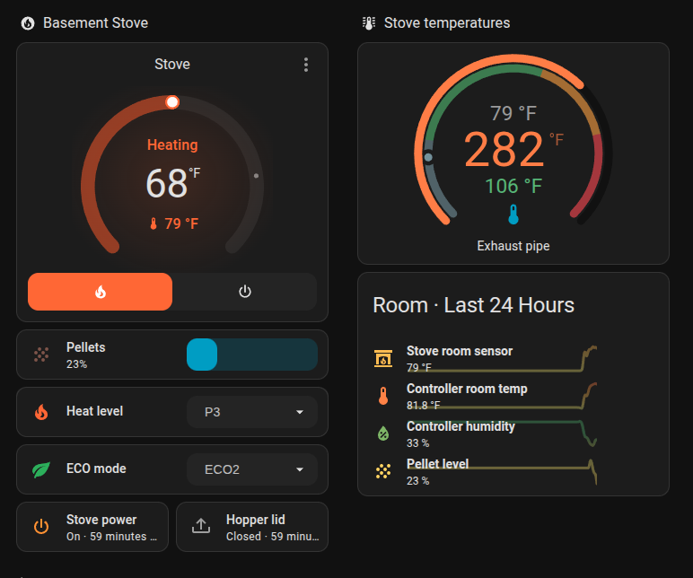
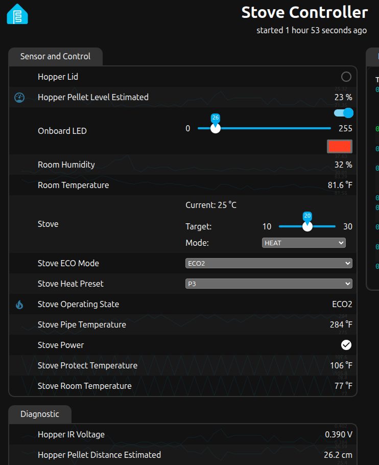

# ESPHome Grand Teton Pellet Stove — Gros Ventre F500460

Local Home Assistant control for a Grand Teton pellet stove through its Tuya
MCU UART. Developed and hardware-tested on the **Grand Teton Collection Gros
Ventre F500460**, sold as the **2200 sq. ft. pellet stove with a 60 lb. hopper**.
Replace the original Wi-Fi module with an ESP32 and control heating, temperature,
heat preset, and ECO mode without the vendor cloud.

The **pellet level sensor and hopper lid/door switch are optional and independent**.
The basic controller needs neither.



*A working installation in Home Assistant. This is a custom dashboard; the
configuration exposes entities rather than installing this layout. The extra
room temperature/humidity sensor in the screenshot is not part of the examples.*

## What works

| Control or reading | Support |
| --- | --- |
| Heat / Off | MCU-acknowledged requests; the stove handles ignition and shutdown |
| Target temperature | Integer Celsius on the wire; HA converts to your display units |
| Heat preset | P1, P2, P3, P4 |
| ECO mode | ECO1, ECO2 |
| Climate activity | Heating for the observed ECO2 running state, even above target |
| Operating state | Standby and ECO2 mapped; other codes shown explicitly as unknown |
| Temperatures | Stove room, pipe/exhaust, and protection temperature |
| Diagnostics | Running hours, raw state/bitmap, UART activity, initialization, Wi-Fi, uptime, reset reason |
| Optional hopper level | Sharp GP2Y0A41SK0F voltage, estimated distance, and estimated fill height |
| Optional hopper lid | Separate dry-contact switch; also gates level readings when both are installed |

## Tested stove and compatibility

| Identifier | Tested installation |
| --- | --- |
| Brand / collection | Grand Teton Collection |
| Stove | Gros Ventre pellet stove |
| Product number | **F500460** |
| Retail description | **2200 sq. ft., 60 lb. hopper** |
| Additional model identifier | **N60WTS**, listed by Tractor Supply for this product |
| Mainboard MCU | ATmega64A |
| Tuya MCU firmware | 1.0.0 |
| Tuya product ID | `mkawgq5ywi0feooe` |

The owner identified the tested stove as the Gros Ventre F500460. The
[Tractor Supply product listing](https://www.tractorsupply.com/tsc/product/grand-teton-collection-gros-ventre-pellet-stove-1-500-to-2-200-sq-ft)
also associates it with model **N60WTS**.

Other models in the Grand Teton Collection line **may be compatible if they use
the same controller and protocol, but have not been tested**. Even the same
retail model can have different board revisions. Compare the wiring, MCU
identity, and [observed datapoints](docs/protocol.md) before enabling writes.
Compatibility reports with an exact model and board/firmware details are welcome.
Cleveland Iron Works stoves are also unverified; a borrowed Cleveland datapoint
map did not match this board.

The hardware-tested baseline used ESPHome **2026.7.4** and an ESP32-S3-WROOM-1
development board with 2 MB quad PSRAM. Dependencies are pinned to that version.
The standalone examples are separately validated and compiled; see
[validation and remaining work](docs/validation.md).

## Hardware and wiring

You need an ESP32-S3 board, a suitable **3.3 V ↔ 5 V logic level shifter**, a USB
power supply, and connections to the stove's four-pin Wi-Fi header. The optional
level sensor adds the Sharp sensor, a resistor divider, and decoupling capacitors.
The lid option adds a **separate** unpowered switch.

- Work on the identified low-voltage wiring with the stove unplugged. Its
  enclosure also contains mains wiring.
- **Disconnect the original Wi-Fi module for controller mode.** Two transmitters
  must not drive the stove's command wire together.
- The tested ESP supply is **USB**. Do not also join stove +5 V to the ESP's 5V
  pin. Stove +5 V supplies the shifter's HV side and optional Sharp sensor.
- Preserve factory switches, interlocks, and protection settings. The optional
  lid sensor is monitoring only; it does not replace a factory interlock.

| Stove header on the tested harness | Level shifter / ESP |
| --- | --- |
| Pin 1, red, +5 V | Shifter HV; optional Sharp Vcc |
| Pin 2, GND | Common GND: stove, shifter, ESP, optional sensors |
| Pin 3, yellow, stove TX | HV1 → LV1 → ESP **GPIO38 RX** |
| Pin 4, white, stove RX | HV2 ← LV2 ← ESP **GPIO37 TX** |
| ESP 3V3 | Shifter LV |

UART is **9600 baud, 8N1**. Verify pin functions on your own board; colors and
connector orientation are not universal. GPIO37 is unavailable on some ESP32-S3
modules with other flash/PSRAM arrangements. Use the CH343 **COM** USB port on
the tested board; its native USB port behaved differently on reset.

[Full wiring, optional sensors, and receive-only capture](docs/wiring.md)

## Choose your configuration

| File | Lid switch | Level sensor |
| --- | --- | --- |
| [`stove.yaml`](stove.yaml) | No | No |
| [`stove-with-lid.yaml`](stove-with-lid.yaml) | Yes | No |
| [`stove-with-level.yaml`](stove-with-level.yaml) | No | Yes |
| [`stove-with-hopper.yaml`](stove-with-hopper.yaml) | Yes | Yes |

Each file is a standalone entry point. The optional packages can also be added
to a copy of `stove.yaml`:

```yaml
packages:
  # Keep the existing network, stove, and hopper_state entries.
  hopper_lid: !include packages/hopper-lid.yaml
  hopper_level: !include packages/hopper-level.yaml
```

When both are included, voltage/distance/level become unknown while the lid is
open or its state is unknown, and for three seconds after closing. **With only
the level sensor, there is no lid-open detection.** An open lid can point the
sensor away from the pellets; ignore those readings or mount it so opening the
lid cannot change its view.

## Install

Using Python 3.12 and a local checkout:

```sh
git clone https://github.com/lizbit-official/esphome-grand-teton-stove.git
cd esphome-grand-teton-stove
python3 -m venv .venv
. .venv/bin/activate
pip install -r requirements.txt
cp secrets.example.yaml secrets.yaml
# Choose ONE example; this one enables both optional sensors.
cp stove-with-hopper.yaml stove.local.yaml
```

Edit `secrets.yaml` with your Wi-Fi credentials, a unique API encryption key,
and a separate OTA password. Generate them locally:

```sh
openssl rand -base64 32  # api_encryption_key
openssl rand -hex 24    # ota_password
```

Edit `stove.local.yaml` to set a unique `device_name` if needed, check GPIOs,
and enter hopper calibration values if you enabled the level sensor. Keep the
`packages/` and `includes/` directories beside the entry-point YAML. ESPHome
Device Builder users need the same relative directory layout.

```sh
esphome config stove.local.yaml
esphome compile stove.local.yaml
# First flash by USB. Replace the port with your board's serial device.
esphome run stove.local.yaml --device /dev/ttyUSB0
```

Do the first wiring/command checks with the stove's **heating off**. Verify
temperature reporting, then a small target change against the physical panel.
Use normal Heat/Off requests for operation; don't interrupt mains power to stop
the stove's shutdown sequence.

The public defaults enable encrypted native API and password-protected OTA.
The web server is **off by default**. To enable its authenticated local UI, add
`web: !include packages/web-server.yaml` under `packages` and fill the two web
secrets. This is HTTP authentication, not HTTPS; keep it on your local network.
Wi-Fi/API loss does not deliberately reboot the ESP (`reboot_timeout: 0s`).

Local `secrets.yaml`, `*.local.yaml`, build output, logs, and firmware binaries
are ignored by Git. Do not publish built firmware: it embeds your credentials.

## Home Assistant

Add the discovered device through **Settings → Devices & services → ESPHome**,
or enter its hostname/IP on port **6053**. Supply your `api_encryption_key`.
Use the `Stove` climate entity in a thermostat card and the heat/ECO selectors
in an Entities card. Entity IDs depend on your chosen device name and HA's
registry; select the actual entities rather than copying someone else's IDs.

Target increments are **1 °C / 1.8 °F**. Temperature sensors publish Celsius
with temperature metadata; HA can display Fahrenheit. P1–P4 and ECO1/ECO2 are
separate selectors, not fan speeds or native climate presets.

**Why Heating above the target?** The observed ECO2 state keeps burning at low
output. Inferring activity only from room versus target temperature incorrectly
reported Idle. This project uses the read-only MCU state code to correct that
case. `Heat`/`Stove Power` still mean the MCU accepted a heating request, not
that ignition has finished or that a flame has independently been detected.

Only state **10 = Standby** and **12 = ECO2** have been correlated so far.
Unmapped phases and lost MCU communication fall back to climate **Idle**;
`Stove Operating State` explicitly reports unknown/unavailable. Startup,
lighting, normal firing, ECO1, and cooldown need more captures. A quiet UART
times out after 45 seconds; continuing heartbeats alone do not prove fresh
phase telemetry. The raw status bitmap is not a decoded fault alarm.

<details>
<summary>ESPHome web UI example</summary>



This screenshot is from the original installation. Its extra room sensors and
internal LED display are not enabled by the standalone examples. Public
temperature readings use Celsius; HA handles display conversion.

</details>

## Hopper reporting cadence

The optional pellet percentage uses a rolling median of 31 one-second samples
and publishes changed whole percentages at most every 30 seconds. Short
reflections no longer produce a rapidly changing percentage. Invalid samples
clear the window; the first valid sample after recovery starts fresh.

Voltage and distance diagnostics publish every 15 seconds. Unknown states and
the first valid reading after recovery bypass that interval. Internal sensor
sampling stays fast, so slowing diagnostics does not slow the pellet filter.
When a lid switch is installed, opening it immediately invalidates all three
readings. Closing it starts the existing three-second settling period before
fresh readings resume. All optional configurations retain the same entity names.

For low-pellet notifications, a useful starting point is below 15% for two
minutes, once per refill, with rearming above 25%. Use a persistent helper to
remember whether that refill cycle has already produced an alert. Treat
unknown or open-lid readings as unavailable, never as zero. Thresholds need
checking against your own hopper calibration.

## Calibrate the optional pellet estimate

The level package works without the lid package. Without calibration it exposes
**Hopper IR Voltage**, while **Hopper Pellet Distance Estimated** and
**Hopper Pellet Level Estimated** remain unknown. This avoids shipping one
owner's hopper dimensions as if they were universal.

With the lid closed, measure the distance from the sensor lenses to the pellets
and record the stable `Hopper IR Voltage` (already corrected for the divider).
Set these substitutions to your own measurements:

```yaml
substitutions:
  hopper_reference_voltage: "0.444"     # EXAMPLE measured sensor-side volts
  hopper_reference_distance_cm: "23.0"  # EXAMPLE distance to pellets
  hopper_full_distance_cm: "4.0"        # measure your planned full level
  hopper_empty_distance_cm: "30.0"      # measure your usable empty level
```

The provisional model is `distance = reference_distance × reference_voltage /
voltage`, then `level = 100 × (empty_distance − distance) / (empty_distance −
full_distance)`. It estimates **fill height**, not pellet mass, volume, or
remaining burn time. A single reference is only a rough approximation; verify
against actual pellets at several levels before using it for alerts.

The Sharp sensor is rated **4–30 cm**. Modeled readings outside that range
become unknown. Keep the closest pellets at least 4 cm from the lenses:
too-close optical ambiguity cannot reliably be detected in software. If your
hopper is deeper than 30 cm, this sensor cannot reliably cover its empty end.
An open lid or disconnected sensor must not be treated as an empty hopper.
See [sensor wiring and limitations](docs/wiring.md#optional-level-sensor).

## Troubleshooting

| Symptom | Check |
| --- | --- |
| Reads work, commands do not | Confirm controller firmware, remove OEM module, check TX/RX directions and shifter LV/HV/GND; reseat loose connectors |
| No Tuya initialization | Check 9600 8N1, common ground, shifter supplies, and header continuity with power off |
| Sensor voltage is zero | The Sharp sensor needs its own 5 V supply; ESP USB alone does not power the stove header |
| Percentage stays unknown | Supply calibration; check lid state/settling delay and 4–30 cm modeled range |
| Lid appears reversed | Override `hopper_lid_inverted`; default is a contact that closes when the lid opens |
| Heating waits in Cooling | Let the stove manage its restart cooldown; repeated start requests are unnecessary |
| Mode is Heat but activity is Idle | Check operating-state code and UART health; only ECO2 activity is mapped today |
| HA cannot connect | Check network reachability and the API encryption key |

For observing an unfamiliar board with its original Wi-Fi module, use the
separate [`stove-sniffer.yaml`](stove-sniffer.yaml) and
[receive-only wiring instructions](docs/wiring.md#receive-only-sniffer).
It has no UART TX pin and no stove controls.

## Development and contributions

```sh
python scripts/check.py            # host tests + all configuration variants
python scripts/check.py --compile  # also compile all variants and the web option
```

Checks use a temporary directory and fake credentials. They never upload
firmware or send stove commands. CI runs the same compile checks. Source-only
contributions are welcome: include the exact stove/board/firmware, raw phase
code, and matching physical-panel label. See [CONTRIBUTING.md](CONTRIBUTING.md).

Advanced feed, ignition, fan calibration, sensor overrides, and protection
settings are deliberately not exposed as remote controls. Their mappings or
permitted ranges remain incomplete.

[MIT license](LICENSE). Independent community project; no manufacturer affiliation.
