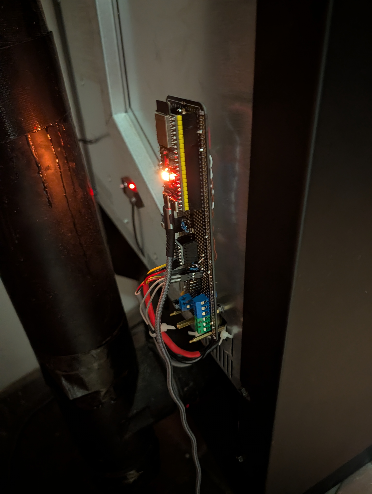

# Wiring reference

This documents one tested harness. Verify connector orientation and pin
functions on your stove before applying power. Connect or move wiring only
with power removed; the enclosure contains mains circuitry.

## Controller mode

The original Tuya WBR3 Wi-Fi module is removed. A generic ESP32-S3-WROOM-1
development board connects through a 3.3 V / 5 V level shifter. Do not connect
5 V UART signals directly to ESP GPIOs.

| Connection | From | To |
| --- | --- | --- |
| Common ground | Stove header pin 2 | ESP GND and both shifter grounds |
| High-side supply | Stove pin 1, red, about 5.2 V observed | Shifter HV |
| Low-side supply | ESP 3V3 | Shifter LV |
| Receive | Stove pin 3, yellow, stove TX | Shifter HV1 → LV1 → GPIO38 |
| Transmit | GPIO37 | Shifter LV2 → HV2 → stove pin 4, white, stove RX |
| ESP supply | USB power | ESP COM USB connector |

Leave stove +5 V disconnected from the ESP 5V pin while USB powers the ESP.
Supply capacity for powering the ESP from the stove has not been validated.
Check the actual ESP module's GPIO availability: GPIO35–37 can be reserved on
some flash/PSRAM variants. The tested board has 2 MB quad PSRAM and GPIO37 free.

The custom carrier and exact level-shifter part have not been fully documented.
This photo is an early prototype, not an enclosure or mounting recommendation.
Use secure connections, strain relief, electrical insulation, and a location
within component temperature limits; keep the electronics away from the flue.

## Optional lid switch

Use a **separate dry contact**, isolated from the stove's wiring. The factory
hopper/door interlock stays connected and functional. Never jumper it for
this integration. The ESP sensor only reports lid position.

Connect the separate switch between **GPIO5 and ESP GND**. The pin uses the
ESP's internal pull-up:

| Physical behavior | `hopper_lid_inverted` |
| --- | --- |
| Contact closes to ground when lid opens | `"true"` (default, tested) |
| Contact closes to ground when lid closes | `"false"` |

`Hopper Lid = Open` must mean the physical lid is open. Confirm both positions
before relying on level gating. The switch must not carry 5 V, mains, or a
signal from the stove controller. This configuration does not command a
shutdown or alter a factory switch when the separate contact changes.

## Optional level sensor

Sensor: **Sharp GP2Y0A41SK0F**, rated 4–30 cm and 4.5–5.5 V supply. Pin numbers
come from the manufacturer's connector drawing, not wire colors.

| Sharp connection | Wiring |
| --- | --- |
| Pin 3, Vcc | Stove +5 V, or another appropriate 5 V supply |
| Pin 2, GND | Common ESP/stove ground |
| Pin 1, Vo | 10 kΩ resistor → GPIO4 junction |
| GPIO4 junction | Second 10 kΩ resistor → GND |
| Local decoupling | At least 10 µF across sensor Vcc/GND; observe capacitor polarity |
| ADC filter capacitor | 100 nF from GPIO4 junction to GND near the ESP |

The divider halves the sensor output; the ADC multiplies by two, so **Hopper
IR Voltage is sensor-side voltage**, not the voltage directly at GPIO4. Keep
the divider's ground intact. The analog signal does not pass through the UART
level shifter. The sensor's operating temperature limit is 60 °C.

If powered from stove +5 V, the sensor is unpowered when the stove's mains
supply is off even though the ESP may still run on USB. A missing or invalid
signal produces an unknown estimate, not a zero-percent fuel reading.

The optional lid package automatically gates the readings when present. Without
it, no physical lid state is known. Use a fixed mounting position or ignore
readings while an unmonitored lid is open.

The sensor needs clearance from the lenses to the nearest pellets: below 4 cm
its output can become ambiguous. An estimated distance inside the accepted
range cannot prove that the target is not physically too close. The original
installation's estimated full/empty geometry extended beyond the rated range;
that geometry is not a recommended mounting specification.

The card response checks (~1.11 V at 10 cm, ~0.63 V at 20 cm) demonstrated a
working sensor, not pellet calibration. Actual pellets measured about 23 cm
away produced ~0.444 V. Surface shape, mounting, and pellet distribution need
to be accounted for with actual refill measurements.

Source: [Sharp GP2Y0A41SK0F datasheet](https://global.sharp/products/device/lineup/data/pdf/datasheet/gp2y0a41sk_e.pdf).

## Receive-only sniffer

`stove-sniffer.yaml` uses two RX-only UARTs and no Tuya component. Its hostname
is `grand-teton-sniffer` by default, distinct from the controller.

With this firmware installed **before attaching parallel taps**, leave the
original module wired normally and tap both signal wires through the shifter:

| Signal | Tap |
| --- | --- |
| Stove TX → original module RX, yellow pin 3 | HV1 → LV1 → GPIO38 `[STOVE>MOD]` |
| Original module TX → stove RX, white pin 4 | HV2 → LV2 → GPIO37 `[MOD>STOVE]` |

Neither GPIO is a transmitter in this build. Even receive-only taps add
electrical loading; confirm that the OEM setup still operates with them
connected. Disconnect the original module before changing to controller
firmware. A successful UART handshake does not prove vendor-app connectivity.

Receive-only logs can help map new states. Avoid publishing network credentials,
MAC/IP details, or complete unrelated logs along with captures.
